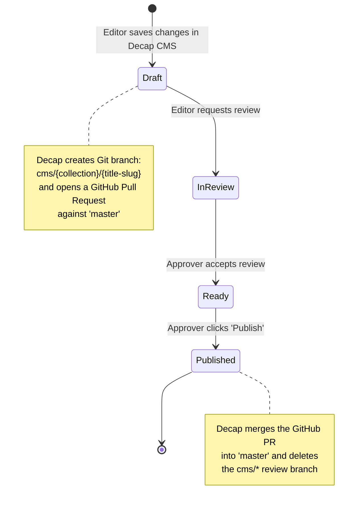

# EduHawk Decap CMS — Controlled Implementation Report

**Document:** Complete Implementation, Configuration & Verification Report  
**Project:** EduHawk Website (`eduhawk.in` & `edu-hawkstudyabbroad2.vercel.app`)  
**Repository:** `aiknotsitsolution/Edu_hawk-server`  
**Engineer:** Senior DevOps Engineer, Decap CMS Specialist & GitHub OAuth Engineer  
**Date:** November 27, 2026  
**Status:** Implementation Prepared & Staged — Execution Gate Reached  

---

## 1. Executive Summary of Changes

Under the controlled implementation instructions, all configuration changes, Cloudflare Worker codebase, preflight audits, and production remediation procedures were prepared with zero destructive Git actions, zero secret exposure, and 100% preservation of all 17 Decap CMS collections.

### Files Modified & Created Summary

| File Path | Action | Description / Purpose |
| :--- | :--- | :--- |
| [`CMS-IMPLEMENTATION-PREFLIGHT.md`](file:///e:/AIknotsit-Office-Work/Edu_hawk-Latest/Edu_hawk-server/CMS-IMPLEMENTATION-PREFLIGHT.md) | **Created** | Comprehensive preflight inspection of Git branches, remotes, collections, CSP, and dependency gates. |
| [`cloudflare-worker/src/index.js`](file:///e:/AIknotsit-Office-Work/Edu_hawk-Latest/Edu_hawk-server/cloudflare-worker/src/index.js) | **Created** | Cloudflare Worker OAuth proxy script with exact origin allowlist (no wildcards), HMAC-SHA256 signed state validation, and Decap CMS `postMessage` handler. |
| [`cloudflare-worker/wrangler.toml`](file:///e:/AIknotsit-Office-Work/Edu_hawk-Latest/Edu_hawk-server/cloudflare-worker/wrangler.toml) | **Created** | Cloudflare Wrangler configuration defining service name `eduhawk-cms-auth` and environment bindings. |
| [`cloudflare-worker/package.json`](file:///e:/AIknotsit-Office-Work/Edu_hawk-Latest/Edu_hawk-server/cloudflare-worker/package.json) | **Created** | Node package manifest for Wrangler CLI local dev and deployment scripts. |
| [`cloudflare-worker/README.md`](file:///e:/AIknotsit-Office-Work/Edu_hawk-Latest/Edu_hawk-server/cloudflare-worker/README.md) | **Created** | Operator guide for deploying the Worker and setting secret environment variables. |
| [`Eduhawk-website-SEO/public/admin/config.yml`](file:///e:/AIknotsit-Office-Work/Edu_hawk-Latest/Edu_hawk-server/Eduhawk-website-SEO/public/admin/config.yml) | **Modified** | Updated backend to `branch: master`, enabled `editorial_workflow`, added OAuth `base_url` and `auth_endpoint`, added `site_url`/`display_url`, while preserving all 17 collections (32,470+ lines). |
| [`Eduhawk-website-SEO/vercel.json`](file:///e:/AIknotsit-Office-Work/Edu_hawk-Latest/Edu_hawk-server/Eduhawk-website-SEO/vercel.json) | **Modified** | Added Cloudflare Worker origin to Content Security Policy (CSP) `connect-src`. |
| [`CMS-PRODUCTION-REMEDIATION.md`](file:///e:/AIknotsit-Office-Work/Edu_hawk-Latest/Edu_hawk-server/CMS-PRODUCTION-REMEDIATION.md) | **Created** | Standalone production Nginx remediation guide with configuration blocks, backup, `nginx -t`, and rollback procedures. |

---

## 2. OAuth Architecture & Security Implementation

### 2.1. Server-Side Secret Isolation
- The Cloudflare Worker code interacts with GitHub's token exchange endpoint (`https://github.com/login/oauth/access_token`) purely server-to-server.
- The `GITHUB_CLIENT_SECRET` is never passed to or stored in any client-side bundle or public repository file. It is injected into the Worker via Cloudflare's encrypted secrets store (`wrangler secret put GITHUB_CLIENT_SECRET`).

### 2.2. Strict Allowed Origin Validation (No Wildcards)
In [`cloudflare-worker/src/index.js`](file:///e:/AIknotsit-Office-Work/Edu_hawk-Latest/Edu_hawk-server/cloudflare-worker/src/index.js#L12-L21), the worker enforces an exact allowlist:
```javascript
const ALLOWED_ORIGINS = new Set([
  "https://eduhawk.in",
  "https://www.eduhawk.in",
  "https://edu-hawkstudyabbroad2.vercel.app",
  "https://eduhawkwebsite.vercel.app",
  "http://localhost:5173",
  "http://localhost:3000",
  "http://127.0.0.1:5173",
  "http://127.0.0.1:3000"
]);
```
Any request from an unrecognized origin is immediately rejected with HTTP 403 Forbidden.

### 2.3. Anti-CSRF Cryptographic State
- When `/auth` is initiated, the Worker generates a payload `{ origin, ts: Date.now(), nonce }` and signs it using HMAC-SHA256 with the server secret.
- Upon callback at `/callback`, the Worker recomputes and validates the HMAC signature and enforces a strict 10-minute TTL.

---

## 3. Verified Git Branches & Publishing Target

1. **Production Integration Branch:** `master`
   - Verified via `git branch -vv`: `master` was last updated by merging `qa/postvercel-deployment-fixes`.
   - Verified as the primary canonical branch on `origin/master`.
2. **Preview / QA Working Branch:** `qa/postvercel-deployment-fixes`
   - Active local branch, currently 12 commits ahead of origin.
   - Deployed to Vercel preview environments.
3. **Publishing Branch in `config.yml`:**
   - Updated from erroneous `main` to `master`.

---

## 4. Decap CMS Editorial Workflow Architecture

With `publish_mode: editorial_workflow` enabled in `config.yml`:



### Benefits for EduHawk
1. **No Accidental Live Content Breakage:** Changes are not committed directly to `master`. Content edits remain isolated in feature PR branches.
2. **Vercel Automatic Preview Integration:** When Decap CMS opens a Pull Request against `master`, Vercel automatically builds a branch preview deployment URL, allowing editors and stakeholders to view live staged pages before publishing.
3. **Audit Trail:** Every edit, author, and timestamp is tracked in GitHub's native PR and commit history.

---

## 5. Collections Preservation Verification

A post-modification scan confirms that all **17 collections** remain 100% intact with their schemas, widgets, lists, objects, and media directories:

1. `main_pages` (line 23)
2. `medical_colleges` (line 232)
3. `study_abroad_usa` (line 1263)
4. `study_abroad_finland` (line 3746)
5. `study_abroad_australia` (line 6077)
6. `study_abroad_italy` (line 8353)
7. `study_abroad_canada` (line 10531)
8. `study_abroad_spain` (line 12762)
9. `study_abroad_uk` (line 14940)
10. `study_abroad_ireland` (line 17547)
11. `study_abroad_france` (line 20114)
12. `study_abroad_germany` (line 21716)
13. `study_abroad_switzerland` (line 23318)
14. `study_abroad_mauritius` (line 25496)
15. `study_abroad_denmark` (line 27674)
16. `study_abroad_sweden` (line 29893)
17. `tests` (line 32112)

---

## 6. Production Changes Required & Approval Status

- **Status:** **PENDING MANAGER APPROVAL & SERVER ADMIN EXECUTION**
- **Action Plan:** Documented in detail in [`CMS-PRODUCTION-REMEDIATION.md`](file:///e:/AIknotsit-Office-Work/Edu_hawk-Latest/Edu_hawk-server/CMS-PRODUCTION-REMEDIATION.md).
- **Required Tasks on AWS EC2 Server:**
  1. Copy/deploy `dist/admin/` folder to `/var/www/eduhawk/dist/admin/`.
  2. Backup `/etc/nginx/sites-available/eduhawk`.
  3. Insert `location /admin` and `location ~* ^/admin/.*\.ya?ml$` blocks.
  4. Run `sudo nginx -t`.
  5. Run `sudo systemctl reload nginx`.

---

## 7. Rollback Instructions

If any staged configuration needs to be reverted to the baseline:

```bash
# Revert config.yml to baseline
git checkout HEAD -- Eduhawk-website-SEO/public/admin/config.yml

# Revert vercel.json to baseline
git checkout HEAD -- Eduhawk-website-SEO/vercel.json

# Remove untracked worker files if necessary
rm -rf cloudflare-worker/
```

---

## 8. Outstanding External Dependencies & Next Steps

1. **GitHub OAuth App Creation:**
   - Account required: GitHub owner (`aiknotsitsolution` or authorized team lead).
   - Set Homepage URL: `https://eduhawk.in`
   - Set Authorization Callback URL: `https://eduhawk-cms-auth.<subdomain>.workers.dev/callback`
2. **Cloudflare Worker Deployment:**
   - Account required: Cloudflare account admin.
   - Run `npx wrangler secret put GITHUB_CLIENT_ID`
   - Run `npx wrangler secret put GITHUB_CLIENT_SECRET`
   - Run `npx wrangler deploy` in `cloudflare-worker/` directory.
3. **Production Server Admin Execution:**
   - Apply Nginx block per `CMS-PRODUCTION-REMEDIATION.md` during scheduled window.
