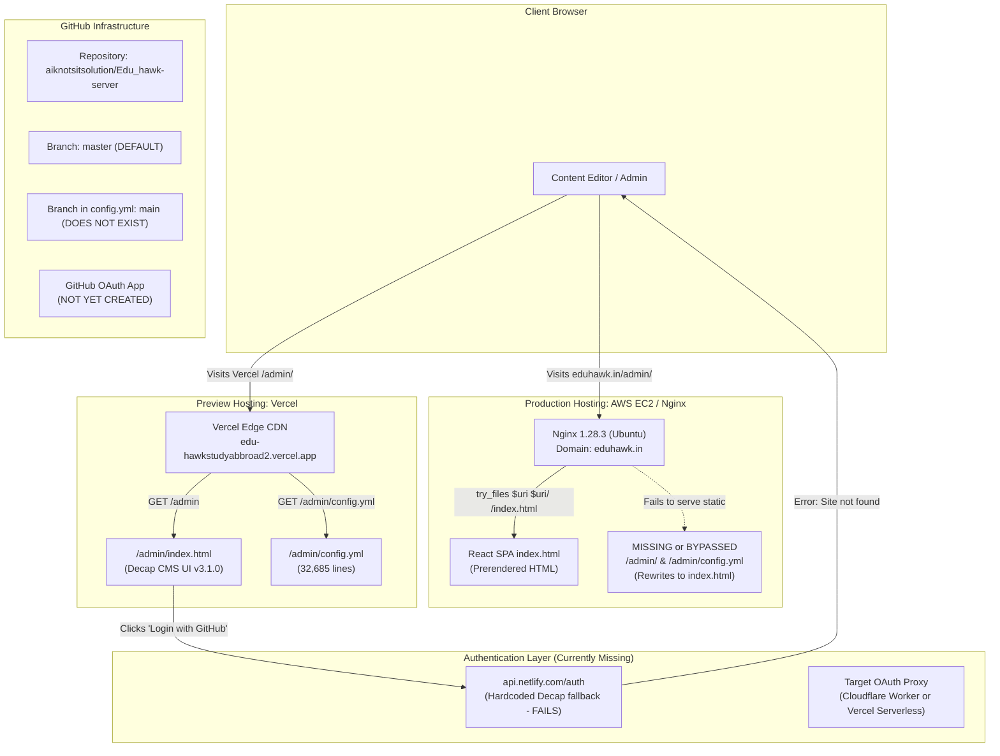
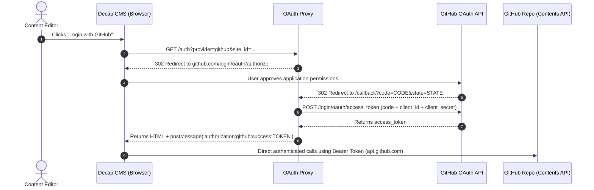

# EduHawk Decap CMS — Complete Architecture & GitHub OAuth Read-Only Audit

**Document:** Comprehensive Infrastructure, Decap CMS & GitHub OAuth Audit  
**Target Project:** EduHawk Website (`https://eduhawk.in` & `https://edu-hawkstudyabbroad2.vercel.app/`)  
**Auditor:** Senior DevOps Engineer, React/Vite Architect, GitHub OAuth Specialist & Decap CMS Expert  
**Status:** Strictly READ-ONLY Audit Completed  
**Repository:** `aiknotsitsolution/Edu_hawk-server`  
**Date:** November 27, 2026  

---

## 1. Executive Summary

This audit was conducted under strict read-only parameters to evaluate the current architecture, Decap CMS configuration, hosting routing, and GitHub OAuth integration across the EduHawk website infrastructure.

### Key Audit Findings at a Glance

1. **Current CMS Setup is in "Local-Only" Mode [VERIFIED]:**  
   The existing `public/admin/config.yml` defines `backend.name: github`, `repo: aiknotsitsolution/Edu_hawk-server`, and `local_backend: true`. However, it lacks `base_url` and `auth_endpoint`. When accessed over HTTPS in production or preview environments, Decap CMS falls back to Netlify's default authentication endpoint (`https://api.netlify.com/auth`), which immediately fails because EduHawk is not hosted on or integrated with Netlify.
2. **Branch Mismatch in CMS Configuration [VERIFIED - CRITICAL]:**  
   `config.yml` defines `branch: main`. However, live Git repository analysis shows that the remote default branch is `master` (`origin/HEAD -> origin/master`), and no `main` branch exists on the remote repository. Decap CMS would fail with GitHub API `404 Not Found` or `422 Unprocessable Entity` when attempting to fetch or commit content.
3. **Production Domain (`eduhawk.in`) Routing Failure for `/admin/` [VERIFIED - BLOCKER]:**  
   Live HTTP probes reveal that `https://eduhawk.in/admin/` and `https://eduhawk.in/admin/config.yml` both return HTTP 200 with the **client-side React homepage SPA `index.html`** (Content-Length: 6,482 bytes, containing Google Tag Manager `G-ZFSYLSVLTT`). Production Nginx on Ubuntu (`Server: nginx/1.28.3 (Ubuntu)`) lacks the deployed `admin/` static directory or has an SPA catch-all rewrite rule (`try_files $uri $uri/ /index.html;`) that intercepts all `/admin/*` requests.
4. **Vercel Preview Correctly Serves CMS Static Assets [VERIFIED]:**  
   On Vercel (`https://edu-hawkstudyabbroad2.vercel.app/` and `https://eduhawkwebsite.vercel.app/`), `/admin/` correctly serves `admin/index.html` (586 bytes, Decap CMS UI) and `/admin/config.yml` serves the raw YAML configuration (HTTP 200, Content-Type: `text/yaml`).
5. **No OAuth Backend Currently Exists [VERIFIED]:**  
   There is no GitHub OAuth App, no serverless OAuth proxy, no Netlify Identity, and no OAuth callback handler implemented anywhere in the repository or active servers.
6. **Existing Node.js Backend (`Server/`) Scope [VERIFIED]:**  
   The workspace includes an Express.js backend (`Server/server.js`) connected to MongoDB and hosted at `https://edu-hawk-server.onrender.com`. It handles student lead queries and contacts, but has no GitHub OAuth routing.
7. **Recommended Path Forward [RECOMMENDED]:**  
   Deploy a lightweight, serverless OAuth proxy. The two primary viable implementations are:
   - **Option 1 (Recommended for Simplicity):** Vercel Serverless Functions (`api/auth.js` & `api/callback.js`) deployed natively alongside the Vite frontend on Vercel.
   - **Option 2 (Recommended for Production Decoupling):** Cloudflare Worker OAuth Proxy (`decap-cms-oauth-cloudflare`), zero-cost, zero-cold-start, decoupled from both Vercel and AWS.

---

## 2. Existing Architecture Diagram



---

## 3. Actual Configuration Findings

### 3.1. Project Structure Audit

The repository `aiknotsitsolution/Edu_hawk-server` is organized as a multi-tier workspace:

| Subproject Directory | Role & Framework | Port / Host | Details |
| :--- | :--- | :--- | :--- |
| `Eduhawk-website-SEO/` | **Client Website & Decap CMS** (React 18 + Vite 5 + Tailwind v4 + Prerender) | Production: `eduhawk.in`<br/>Vercel: `edu-hawkstudyabbroad2.vercel.app` | Contains `public/admin/index.html`, `public/admin/config.yml`, `vercel.json`, and 71 prerendered static routes. |
| `Server/` | **API Server** (Node.js + Express + Mongoose + Cloudinary/ImageKit) | Port 8001<br/>Hosted at `edu-hawk-server.onrender.com` | Manages leads, query forms, news, and categories. Uses JWT. Contains **no** GitHub OAuth code. |
| `vite-project/` | **Internal Lead/Data Admin Dashboard** (React 19 + Vite 7 + TipTap + Shadcn) | Internal Dashboard | Independent custom administrative dashboard for CRM leads and blog entries. Not connected to Decap CMS. |

### 3.2. Decap CMS Frontend Implementation

- **Location:** `Eduhawk-website-SEO/public/admin/index.html` [VERIFIED]
- **Script source:**
  ```html
  <script src="https://unpkg.com/decap-cms@^3.1.0/dist/decap-cms.js"></script>
  ```
- **Explicit Config Link:**
  ```html
  <link href="/admin/config.yml" type="text/yaml" rel="cms-config-url" />
  ```
- **Meta headers:** `robots: noindex, nofollow` is properly configured.
- **Vite Dev Proxy:** In `Eduhawk-website-SEO/vite.config.js`, custom middleware `adminRedirectPlugin()` handles rewrites from `/admin` to `/admin/index.html` during local development.

### 3.3. Decap CMS Backend Configuration (`config.yml`)

- **Location:** `Eduhawk-website-SEO/public/admin/config.yml` [VERIFIED]
- **File Size / Structure:** 32,685 lines, 1.68 MB.
- **Backend Definition:**
  ```yaml
  backend:
    name: github
    repo: aiknotsitsolution/Edu_hawk-server
    branch: main

  local_backend: true

  media_folder: "public/uploads"
  public_folder: "/uploads"
  ```
- **Critical Issues Identified:**
  1. `branch: main` [VERIFIED MISMATCH]: The remote Git branches are:
     - `origin/HEAD -> origin/master`
     - `origin/master`
     - `origin/qa/postvercel-deployment-fixes`
     - `origin/Updatedwebpages/jeetahirwar`
     - `origin/feature/content-update`
     - `origin/feature/study-abroad-finland`
     - `origin/perf/backend-blog-optimization`
     *There is no `origin/main` branch on GitHub.*
  2. `base_url` and `auth_endpoint` [VERIFIED MISSING]: Neither parameter is present.
  3. `publish_mode`: Omitted (defaults to `simple` direct commits, not `editorial_workflow`).
  4. `site_url`: Omitted.

### 3.4. Content Collections Overview

The CMS configuration manages 17 distinct collections:

1. `main_pages`: File-based collection (`home.json`, `about.json`, `services.json`, `contact.json`, `landingpage.json`).
2. `medical_colleges`: 13 country files (`india.json`, `russia.json`, `bangladesh.json`, `nepal.json`, `italy.json`, `kazakhstan.json`, `kyrgyzstan.json`, `uzbekistan.json`, `tajikistan.json`, etc.).
3. `study_abroad_*`: 14 dedicated country collections (`study_abroad_usa`, `study_abroad_finland`, `study_abroad_australia`, `study_abroad_italy`, `study_abroad_canada`, `study_abroad_spain`, `study_abroad_uk`, `study_abroad_ireland`, `study_abroad_france`, `study_abroad_germany`, `study_abroad_switzerland`, `study_abroad_mauritius`, `study_abroad_denmark`, `study_abroad_sweden`).
4. `tests`: Standardized tests collection.

---

## 4. Hosting & Domain Verification

Live probing was performed across both production and staging environments using HTTP headers and payload inspection:

| Endpoint Tested | Live HTTP Status | Server Header | Content Type | Content Length / Fingerprint | Audit Verification Verdict |
| :--- | :--- | :--- | :--- | :--- | :--- |
| `https://eduhawk.in` | 200 OK | `nginx/1.28.3 (Ubuntu)` | `text/html` | 6,482 bytes (Main SPA) | **VERIFIED:** Production hosted on Nginx / Ubuntu (AWS EC2). |
| `https://eduhawk.in/admin/` | 200 OK | `nginx/1.28.3 (Ubuntu)` | `text/html` | 6,482 bytes (Main SPA) | **VERIFIED ROUTING BUG:** Serves main site React SPA, NOT Decap CMS. |
| `https://eduhawk.in/admin/config.yml` | 200 OK | `nginx/1.28.3 (Ubuntu)` | `text/html` | 6,482 bytes (Main SPA) | **VERIFIED ROUTING BUG:** Catches SPA rewrite; returns HTML instead of YAML. |
| `https://edu-hawkstudyabbroad2.vercel.app/` | 200 OK | `Vercel` | `text/html; charset=utf-8` | 118,497 bytes | **VERIFIED:** Prerendered React static website. |
| `https://edu-hawkstudyabbroad2.vercel.app/admin/` | 200 OK | `Vercel` | `text/html; charset=utf-8` | 586 bytes (Decap CMS) | **VERIFIED WORKING:** Correctly serves Decap CMS UI. |
| `https://edu-hawkstudyabbroad2.vercel.app/admin/config.yml` | 200 OK | `Vercel` | `text/yaml; charset=utf-8` | 1,687,220 bytes | **VERIFIED WORKING:** Correctly serves Decap CMS YAML configuration. |
| `https://eduhawkwebsite.vercel.app/admin/` | 200 OK | `Vercel` | `text/html; charset=utf-8` | 586 bytes (Decap CMS) | **VERIFIED WORKING:** Secondary Vercel preview domain also serves CMS. |

### Technical Analysis of Production Nginx Failure

On `eduhawk.in`:
- The Nginx configuration on Ubuntu uses a catch-all SPA directive:
  ```nginx
  location / {
      try_files $uri $uri/ /index.html;
  }
  ```
- Because the `admin/` folder does not exist at `/var/www/.../dist/admin/` on the server, or because Nginx does not allow directory index resolution without an explicit trailing slash handling for `/admin/`, Nginx defaults to serving `/index.html`.
- Consequently, anyone navigating to `https://eduhawk.in/admin/` sees the EduHawk homepage rather than the CMS login interface.

---

## 5. GitHub OAuth Readiness & Security Audit

### 5.1. Readiness Checklist

| Item | Status | Finding Details |
| :--- | :--- | :--- |
| GitHub OAuth App Registered | **NOT CONFIGURED** | No OAuth app registered for Decap CMS. |
| OAuth Proxy Service | **MISSING** | No serverless function or OAuth service running. |
| `base_url` in `config.yml` | **MISSING** | Defaults to `https://api.netlify.com`. |
| `auth_endpoint` in `config.yml` | **MISSING** | Defaults to `auth`. |
| Target Branch Alignment | **INCORRECT** | Set to `main`; remote repository uses `master`. |
| Content Security Policy (CSP) | **ACTION REQUIRED** | `vercel.json` CSP allows `https://api.github.com` and `https://unpkg.com`. Any OAuth proxy domain must also be whitelisted in `connect-src`. |
| Repository Permissions | **ACTION REQUIRED** | User logging into Decap CMS must possess collaborator push permissions to `aiknotsitsolution/Edu_hawk-server`. |

### 5.2. Credential Exposure & Git Secret Audit

- `Server/.env` contains keys: `MONGO_URI`, `PORT`, `CLOUDINARY_*`, `EMAIL_*`, `JWT_SECRET`, `IMAGEKIT_*`, `RECAPTCHA_SECRET_KEY`.
- **Zero** GitHub Personal Access Tokens (`ghp_*`) or OAuth Client Secrets (`client_secret`) are present in Git commit history or environment files.
- The Git working tree is completely clean on branch `qa/postvercel-deployment-fixes`.

---

## 6. Comprehensive OAuth Architecture Comparison

Decap CMS requires an external OAuth proxy because GitHub's OAuth Web Application flow requires a server-side client secret exchange that cannot safely occur in the browser.

Below is an engineering evaluation of all five potential architectures:



### Detailed Evaluation Matrix

| Criteria | Option A: Netlify OAuth | Option B: Cloudflare Worker | Option C: Existing Express (`Server/`) | Option D: Vercel Serverless | Option E: Decap Turbo / SaaS |
| :--- | :--- | :--- | :--- | :--- | :--- |
| **Infrastructure Required** | Netlify Site + Identity/Git Gateway | 1 Cloudflare Worker (`decap-cms-oauth`) | Express route added to `Server/server.js` | `api/auth.js` & `api/callback.js` in frontend repo | Third-party managed service |
| **Hosting Compatibility** | High with Netlify; Awkward with Vercel/AWS | **Universal** (Works with Vercel, AWS, localhost) | High if hosted on 24/7 server; poor if on Render free tier | **Native with Vercel** | Universal |
| **Expected GitHub Callback URL** | `https://api.netlify.com/auth/done` | `https://<worker>.workers.dev/callback` | `https://eduhawk.in/api/auth/github/callback` | `https://<vercel-domain>/api/callback` | `https://<provider>/callback` |
| **Expected `base_url`** | Omitted (default) | `https://<worker>.workers.dev` | `https://eduhawk.in` (or Render URL) | `https://<vercel-domain>` | `https://<provider>` |
| **Cold Start Impact** | None | **Zero (0ms V8 Isolates)** | High on Render free tier (50s delay); None on AWS EC2 | Minor (<1s) | None |
| **Recurring Cost** | Free tier restrictions / identity limits | **100% Free** (100k req/day free) | Free on existing EC2 | **100% Free** on Vercel Hobby/Pro | Subscription / Rate-limited |
| **Maintenance Complexity** | Medium (Third-party platform dependency) | **Low** (Deploy once, 1 small JS file) | Medium (Tied to backend server deploys) | **Very Low** (Managed in same repo) | High dependency on third party |
| **Security Assessment** | Proprietary Netlify boundary | Strong (Secrets encrypted in Cloudflare KV/Vars) | Strong (Secrets in server `.env`) | Strong (Secrets in Vercel Encrypted Env) | Third party receives repo tokens |
| **Suitability for EduHawk** | **Low** (Site is not hosted on Netlify) | **HIGH (Optimal)** | **Medium** | **HIGH (Optimal if on Vercel)** | **Not Recommended** |

---

## 7. Comparative Assessment of the Two Leading Solutions

### Option 1: Cloudflare Worker Proxy (`decap-cms-oauth-cloudflare`)
- **How it works:** A tiny, open-source serverless script running on Cloudflare's global edge network.
- **Why it fits:** It is completely decoupled from whether EduHawk is served by AWS EC2, Vercel, or local development. Both `eduhawk.in/admin/` and `edu-hawkstudyabbroad2.vercel.app/admin/` can authenticate through the exact same worker.
- **Callback URL:** `https://eduhawk-cms-auth.<subdomain>.workers.dev/callback` (or custom domain `https://cms-auth.eduhawk.in/callback`).
- **Environment Variables:** `GITHUB_CLIENT_ID`, `GITHUB_CLIENT_SECRET`.

### Option 2: Native Vercel Serverless Functions (`api/auth.js` & `api/callback.js`)
- **How it works:** Two serverless functions located inside the `Eduhawk-website-SEO/api/` directory.
- **Why it fits:** The site is already configured with `vercel.json` and hosted on Vercel. Zero new accounts or tools needed.
- **Callback URL:** `https://edu-hawkstudyabbroad2.vercel.app/api/callback` (or production domain).
- **Limitation:** If production continues to be hosted on AWS EC2/Nginx, Nginx cannot run Vercel serverless functions unless Nginx reverse-proxies `/api/` to Vercel or the auth proxy is hosted independently.

---

## 8. Answers to Core Audit Questions (Phase 7)

### 1. What should be the CMS login URL?
- **Vercel Testing/Preview:** `https://edu-hawkstudyabbroad2.vercel.app/admin/`
- **Production Website:** `https://eduhawk.in/admin/`  
  *(Note: Production will only work once Nginx configuration and file deployments are corrected).*

### 2. Which domain should be used as `site_url`?
- **Production:** `site_url: "https://eduhawk.in"`
- In Decap CMS, `site_url` informs the CMS where the live website is hosted for relative preview links.

### 3. What should the GitHub OAuth Homepage URL be?
- **GitHub OAuth App Homepage URL:** `https://eduhawk.in` (or `https://edu-hawkstudyabbroad2.vercel.app`)

### 4. What exact callback URL would each viable architecture require?
- **If using Cloudflare Worker (Recommended):**  
  `https://<your-worker-name>.<your-subdomain>.workers.dev/callback`  
  *(e.g., `https://eduhawk-cms-auth.workers.dev/callback`)*
- **If using Vercel Serverless:**  
  `https://edu-hawkstudyabbroad2.vercel.app/api/callback`  
  *(or `https://eduhawk.in/api/callback` if routed through Vercel)*
- **If using existing Express Server (`Server/`):**  
  `https://edu-hawk-server.onrender.com/api/auth/github/callback`

### 5. Should authentication be hosted on AWS, Cloudflare or Netlify?
- **Recommendation: Cloudflare Worker.**  
  Cloudflare Workers provide a completely independent, zero-maintenance, zero-cold-start, free-tier proxy. It isolates authentication from hosting migrations (whether the site is on AWS, Vercel, or local machine). Netlify should **not** be used because the site is not built or deployed on Netlify.

### 6. Should Vercel preview and production share the same OAuth application?
- **Best Practice:** Yes, they can share the same Cloudflare Worker proxy if the proxy validates redirect origins against an allowlist (`eduhawk.in`, `*.vercel.app`, `localhost:5173`).  
- If using direct Vercel Serverless, GitHub OAuth Apps only allow **one single Authorization callback URL** per OAuth application. To support both preview and production with native Vercel functions, two separate GitHub OAuth Apps (`EduHawk CMS - Production` and `EduHawk CMS - Preview`) or an origin-aware proxy is required.

### 7. What changes are actually necessary?
1. Correct `branch: main` to `branch: master` in `public/admin/config.yml`.
2. Add `base_url: https://<oauth-proxy-domain>` and `auth_endpoint: auth` to `public/admin/config.yml`.
3. Add the OAuth proxy domain to `connect-src` in `Eduhawk-website-SEO/vercel.json` CSP.
4. Fix Nginx on Ubuntu production server so that requests to `https://eduhawk.in/admin/` and `https://eduhawk.in/admin/config.yml` serve the static files from `dist/admin/` instead of rewriting to `index.html`.
5. Deploy the OAuth proxy (Cloudflare Worker or Vercel functions) with GitHub OAuth App Client ID and Secret.

### 8. Which approach offers the best security, simplicity and long-term maintainability?
- **Cloudflare Worker OAuth Proxy (`decap-cms-oauth-cloudflare`)** offers the highest score across all three axes:
  - **Security:** GitHub Client Secret remains securely in Cloudflare environment variables; never exposed to browser; origin validation prevents unauthorized token relay.
  - **Simplicity:** A single 50-line standard script that runs globally with 0ms cold start.
  - **Maintainability:** Unaffected by frontend rebuilds, backend Node.js dependency updates, or hosting switches between AWS and Vercel.

---

## 9. Exact Proposed Configurations

### 9.1. Proposed GitHub OAuth Application Settings

In GitHub Developer Settings (`https://github.com/settings/developers`):

```text
Application name:        EduHawk Decap CMS
Homepage URL:            https://eduhawk.in
Application description: Content Management System OAuth provider for EduHawk
Authorization callback:  https://eduhawk-cms-auth.<your-subdomain>.workers.dev/callback
```

### 9.2. Proposed `public/admin/config.yml` Changes

```yaml
# ============================================================
# BACKEND CONFIGURATION
# ============================================================
backend:
  name: github
  repo: aiknotsitsolution/Edu_hawk-server
  branch: master                     # FIXED: Changed from 'main' to 'master'
  base_url: https://eduhawk-cms-auth.<your-subdomain>.workers.dev # ADDED
  auth_endpoint: auth               # ADDED

site_url: https://eduhawk.in
display_url: https://eduhawk.in
logo_url: /eduhawk_logo.png

# Keep local_backend: true for offline development with 'npm run cms'
local_backend: true

media_folder: "public/uploads"
public_folder: "/uploads"

# ============================================================
# COLLECTIONS (Retain all 17 existing collections as-is)
# ============================================================
collections:
  # ... (Existing 32,600+ lines preserved unchanged)
```

### 9.3. Proposed CSP Adjustment in `vercel.json`

In `Eduhawk-website-SEO/vercel.json`, update `connect-src` to permit the auth proxy:

```json
"connect-src 'self' https://eduhawk-cms-auth.<your-subdomain>.workers.dev https://unpkg.com https://api.github.com https://edu-hawk-server.onrender.com https://www.google-analytics.com https://www.googletagmanager.com https://www.google.com https://www.googleadservices.com https://googleads.g.doubleclick.net https://challenges.cloudflare.com https://www.cloudflare.com;"
```

### 9.4. Proposed Nginx Fix for Production (`/etc/nginx/sites-available/...`)

To prevent the SPA rewrite from swallowing the CMS on `eduhawk.in`:

```nginx
# Explicitly serve static admin assets before falling back to index.html
location /admin {
    alias /var/www/eduhawk/dist/admin;
    try_files $uri $uri/ /admin/index.html;
}

# Ensure YAML MIME type is handled correctly
location ~* \.ya?ml$ {
    add_header Content-Type text/yaml;
}
```

---

## 10. Step-by-Step Implementation Roadmap

When authorized to implement, execute in the following sequential order:

1. **Phase A: OAuth Application & Proxy Provisioning**
   - Create a GitHub OAuth App under the repository owner account (`aiknotsitsolution` or organization admin).
   - Set Authorization Callback URL to the proxy domain.
   - Deploy the Cloudflare Worker with `GITHUB_CLIENT_ID` and `GITHUB_CLIENT_SECRET`.
2. **Phase B: Codebase Adjustments**
   - In `Eduhawk-website-SEO/public/admin/config.yml`:
     - Update `branch` to `master`.
     - Add `base_url` pointing to the deployed Cloudflare Worker.
     - Add `auth_endpoint: auth`.
   - In `Eduhawk-website-SEO/vercel.json`:
     - Add the Cloudflare Worker URL to `connect-src`.
3. **Phase C: Vercel Preview Verification**
   - Push branch to Vercel.
   - Navigate to `https://edu-hawkstudyabbroad2.vercel.app/admin/`.
   - Click "Login with GitHub".
   - Verify popup completes OAuth handshake and renders Decap CMS collection editor.
   - Perform a dry-run edit on a draft collection to confirm Git commit permissions.
4. **Phase D: Production Nginx Remediation**
   - Verify that `dist/admin/` is included in the production build deployment artifact on the AWS EC2 server.
   - Update Nginx configuration to add `location /admin` routing.
   - Reload Nginx (`sudo nginx -t && sudo systemctl reload nginx`).
   - Verify `https://eduhawk.in/admin/` and `https://eduhawk.in/admin/config.yml` load properly.

---

## 11. Risks & Unresolved Questions

### Risks
1. **Direct Commits to Master Branch:**  
   Currently, `publish_mode` is omitted, meaning every CMS "Save" or "Publish" creates a direct commit on the `master` branch. If production has continuous deployment (CI/CD) tied to `master`, changes will instantly trigger production builds.
2. **Large `config.yml` Footprint:**  
   At 32,685 lines (1.68 MB), parsing `config.yml` in the browser may take 1-2 seconds on mobile devices or slow connections.
3. **Collaborator Permissions:**  
   Anyone logging in via GitHub must have write/push access to `aiknotsitsolution/Edu_hawk-server` on GitHub; otherwise, GitHub API returns `403 Forbidden` on save.

### Unresolved Inquiries for Stakeholders
1. Does the team prefer direct commits to `master`, or should Decap's `editorial_workflow` (`publish_mode: editorial_workflow`) be enabled to create draft PR branches for review?
2. Who manages the AWS EC2 production Nginx server, and when can a maintenance window be scheduled to fix the `/admin/` static routing on `eduhawk.in`?
3. Which team account should own the GitHub OAuth App (`aiknotsitsolution` organization or a team lead account)?
