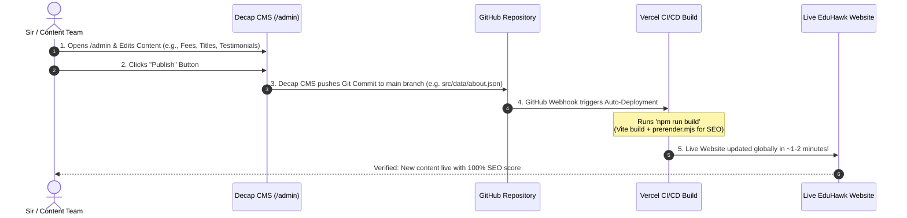
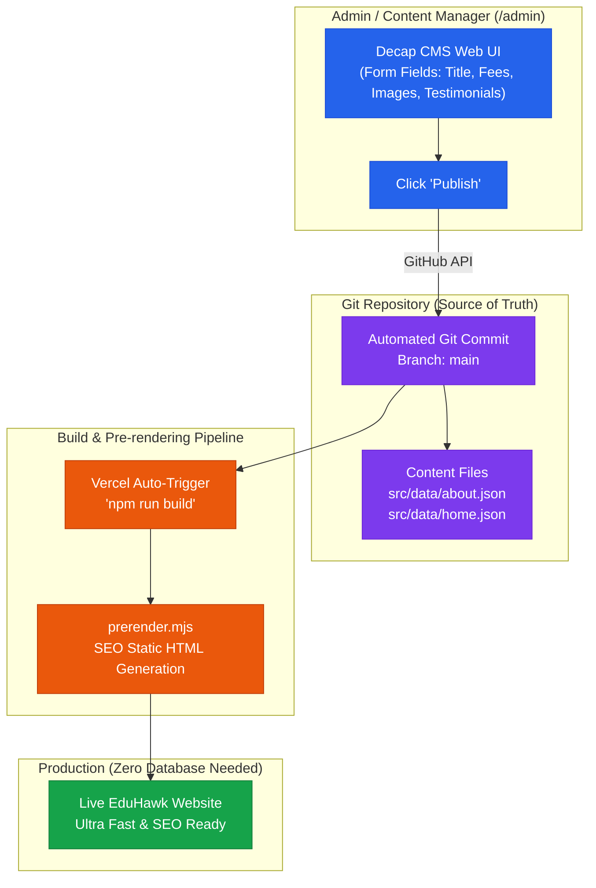
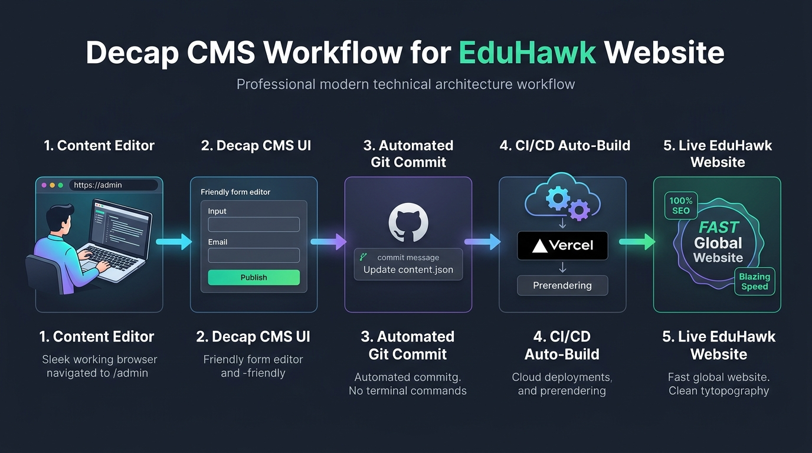

# Decap CMS (Git-based CMS) Complete Setup & Implementation Plan for EduHawk

> **Target Project:** EduHawk Website (`Eduhawk-website-SEO`)  
> **Architecture Type:** Git-based Decoupled Headless CMS (Zero Database, Zero Backend Server Cost)  
> **Author:** Antigravity Engineering Team  
> **Status:** Ready for Execution  

---

## 📋 Step-by-Step Implementation Checklist

- [ ] **Step 1: Content Decoupling (Data Layer Setup)**
  - [ ] `src/data/` directory create karna
  - [ ] `About.jsx` ka hardcoded content extract karke `src/data/about.json` me convert karna
  - [ ] `About.jsx` ko refactor karna taaki sara data `about.json` se dynamic render ho
  - [ ] Local build & dev verify karna (ensure styling & prerender bilkul intact rahe)

- [ ] **Step 2: Decap CMS Client Files Setup**
  - [ ] `public/admin/index.html` create karna (Decap CMS core script load)
  - [ ] `public/admin/config.yml` create karna (backend, collections, fields & `local_backend: true`)
  - [ ] `public/uploads/` directory ensure karna media/images ke liye

- [ ] **Step 3: Local Testing & Validation**
  - [ ] Local proxy server start karna (`npx decap-server`)
  - [ ] Vite dev server start karna (`npm run dev`)
  - [ ] Browser me `http://localhost:5173/admin/` open karke test karna
  - [ ] Test edit karna (e.g. Russia MBBS fees ya title) aur "Publish" dabana
  - [ ] Verify karna ki `src/data/about.json` automatically update hui aur browser me hot-reload hua

- [ ] **Step 4: Extension to Other Pages (Incremental Rollout)**
  - [ ] Landing page (`Landingpage/`) sections ko `src/data/landing.json` me shift karna
  - [ ] Courses / Study Abroad country data ko `config.yml` me map karna
  - [ ] Testimonials & FAQ data ko config me add karna

- [ ] **Step 5: Production GitHub OAuth & Deployment Setup**
  - [ ] GitHub Developer Settings me OAuth App create karna (Client ID & Secret)
  - [ ] Vercel me OAuth endpoint / environment variables add karna
  - [ ] Production build test karna (`npm run build` ➔ Vite + `prerender.mjs`)
  - [ ] `https://eduhawk.in/admin` live verify karna aur Sir ke sath review karna

---

## 1. Executive Summary

EduHawk website ke pages ka content dynamic banana hai taaki **3–6 mahine baad bina technical dependency aur bina kisi code breakage ke content update ho sake**. 

Sir ke decision ke anusaar **Option 3 (Git-based CMS: Decap CMS)** select kiya gaya hai. 

### Why Decap CMS?
1. **Zero Database / Zero Backend:** Alag se koi MongoDB/SQL ya server maintain karne ki zaroorat nahi.
2. **Simple Form-based UI:** Content writers ya management ko code nahi dekhna padega, unhe direct web forms milenge (`/admin`).
3. **Automated Git Commits:** CMS me "Publish" button dabate hi automatic GitHub commit create hota hai.
4. **100% SEO Friendly:** EduHawk ka existing Vite + `prerender.mjs` setup as-it-is build hokar search engines ke liye static HTML generate karta rahega.
5. **Completely Free:** Hosting aur storage GitHub + Vercel par hi rehta hai, koi monthly CMS subscription fee nahi.

---

## 2. Visual Architecture & Workflow Diagram

Neeche diya gaya diagram Decap CMS ka complete end-to-end data flow aur lifecycle dikhata hai:



---

## 3. High-Level Architecture Flowchart



---

## 4. Visual Workflow Infographic

Neeche diya gaya infographic visual Decap CMS ke 5-step automated workflow ko darshata hai:



---

## 5. Detailed Implementation Plan (Phase-wise)

### Phase 1: Decouple Existing Content into JSON Structure
Abhi `About.jsx`, `Landingpage`, etc. me texts hardcoded hain. Hum inka content `src/data/` folder me shift karenge.

- **Files to create:**
  - `src/data/about.json`
  - `src/data/home.json`
  - `src/data/courses.json`
  - `src/data/testimonials.json`
- **Component refactoring:**
  - `About.jsx` me `import aboutData from '../data/about.json'` laga kar JSX me bind karenge: `{aboutData.heroTitle}`.

---

### Phase 2: Decap CMS Setup (`public/admin`)
Decap CMS client-side chalta hai. Iske liye sirf 2 files chahiye hoti hain:

#### 1. `public/admin/index.html`
```html
<!doctype html>
<html lang="en">
  <head>
    <meta charset="utf-8" />
    <meta name="viewport" content="width=device-width, initial-scale=1.0" />
    <title>EduHawk Content Manager</title>
  </head>
  <body>
    <!-- Decap CMS Core Script -->
    <script src="https://unpkg.com/decap-cms@^3.1.0/dist/decap-cms.js"></script>
  </body>
</html>
```

#### 2. `public/admin/config.yml`
```yaml
backend:
  name: github
  repo: your-github-username/Edu_hawk-server # GitHub Repo Path
  branch: main # Target branch

# Local development me bina GitHub login ke test karne ke liye:
local_backend: true

# Media / Images upload directory:
media_folder: "Eduhawk-website-SEO/public/uploads"
public_folder: "/uploads"

collections:
  - name: "pages"
    label: "Pages Content"
    delete: false
    files:
      - label: "About Page Content"
        name: "about_page"
        file: "Eduhawk-website-SEO/src/data/about.json"
        fields:
          - { label: "Hero Title", name: "heroTitle", widget: "string" }
          - { label: "Hero Subtitle", name: "heroSubtitle", widget: "text" }
          - { label: "Banner Image", name: "heroBanner", widget: "image" }
          - label: "MBBS Countries"
            name: "countries"
            widget: "list"
            fields:
              - { label: "Country Name", name: "name", widget: "string" }
              - { label: "Total Seats", name: "seats", widget: "string" }
              - { label: "Package Fee", name: "fee", widget: "string" }
          - label: "Student Testimonials"
            name: "testimonials"
            widget: "list"
            fields:
              - { label: "Student Name", name: "name", widget: "string" }
              - { label: "Location", name: "loc", widget: "string" }
              - { label: "Review Text", name: "text", widget: "text" }
              - { label: "Rating Stars", name: "stars", widget: "number", value_type: "int", min: 1, max: 5 }
```

---

### Phase 3: Local Testing (Zero Auth Needed)

Local machine par bina GitHub token ya complex setup ke test karne ke liye:
1. `npx decap-server` command run karenge (jo local proxy server start karega).
2. `npm run dev` start karenge.
3. Browser me `http://localhost:5173/admin/` open karenge.
4. Form me changes karke "Publish" karenge ➔ Local JSON file turant update ho jayegi aur browser me page hot-reload ho jayega!

---

### Phase 4: Production Authentication (GitHub OAuth Setup)

Production me jab website `eduhawk.in/admin` par khulegi, toh GitHub OAuth verify karega ki Sir ya authorized team member hi content edit kar sakte hain.

Do simple tareeqe hain:
1. **Option A (GitHub OAuth via Free Serverless Proxy):**
   - GitHub Developer Settings me ek OAuth App banate hain (`Client ID` aur `Client Secret`).
   - Ek free serverless proxy (jaise Vercel function ya Decap OAuth provider) setup karte hain.
2. **Option B (Netlify Identity & Git Gateway):**
   - Agar frontend Netlify par deploy hota hai, toh 1-click me Netlify Identity se invite-only login chalu ho jata hai.
   - Vercel ke sath Option A sabse standard aur clean hai.

---

## 6. How Sir / Content Team Will Use This (Future Workflow)

Jab bhi 3–6 mahine baad content change karna ho:

1. **Step 1:** Browser me `https://eduhawk.in/admin` open karo.
2. **Step 2:** Login karo (Sir ya authorized team member).
3. **Step 3:** Jo page update karna hai use select karo (e.g. *About Page*, *Landing Page*, *Courses*).
4. **Step 4:** Fields me naya text, updated fees, ya nayi image upload karo.
5. **Step 5:** Top right corner par **"Publish"** button daba do.

**Bas itna hi!**  
Peeche background me:
- Decap CMS GitHub repo me naya commit push karega.
- Vercel automatic build run karega (`vite build + prerender`).
- 90–120 seconds ke andar updated content live ho jayega, aur Google SEO indexing bhi bilkul intact rahegi!

---

## 7. Security & Backup Guarantee

- **Full Version History:** Har content change Git history me record hota hai. Agar koi galti se galat text daal de, toh 1-click me purana version rollback kiya ja sakta hai.
- **Access Control:** Sirf wahi log `/admin` access kar sakte hain jinko GitHub repo ya invite token ka access diya gaya ho.
- **Zero Hack Risk:** Database na hone ki wajah se SQL Injection ya database leak ka risk 0% hai.
